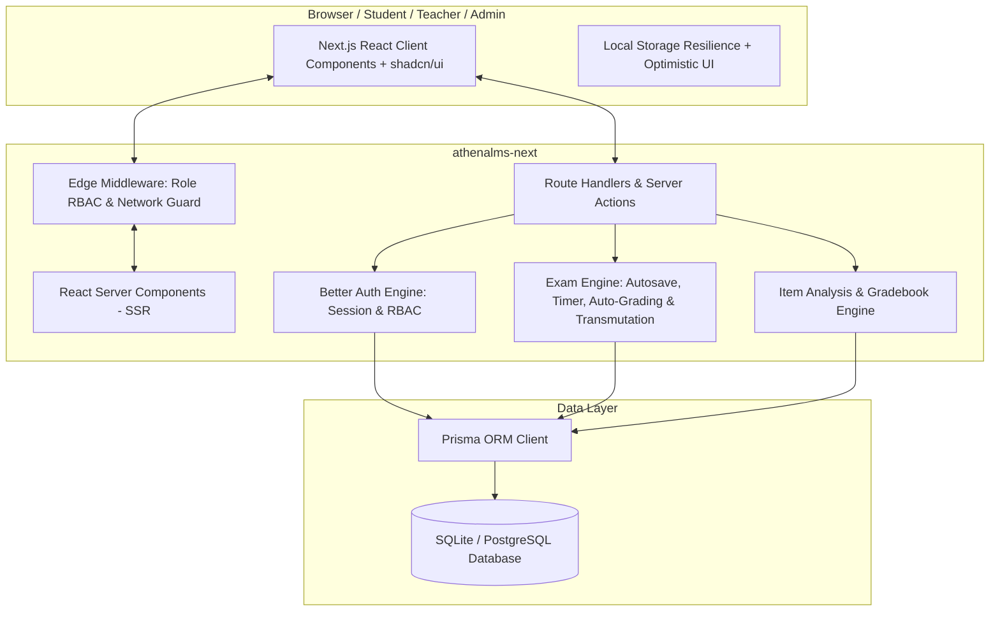
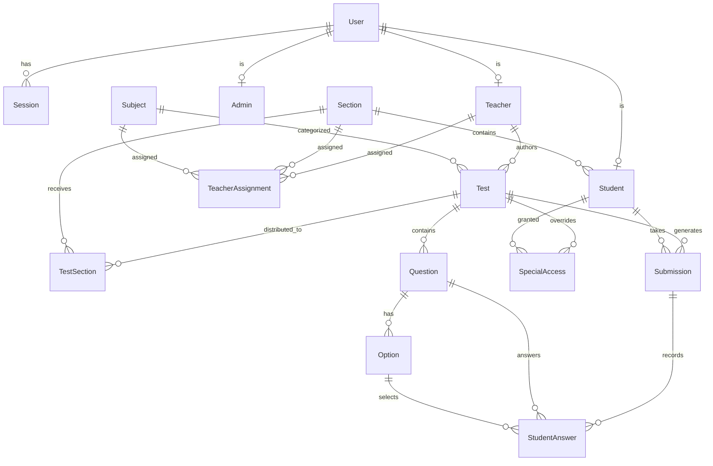

# Software Requirements Specification (SRS)
## Project: Athena LMS (Next.js Edition)
**Document Version:** 1.0  
**Status:** Approved for Implementation  
**Date:** October 16, 2026  
**Author:** Antigravity Senior Systems Architecture Team  
**System Target:** Full-stack Next.js (`athenalms-next`)

---

## 1. Introduction

### 1.1 Purpose
This Software Requirements Specification (SRS) describes the complete functional, non-functional, security, and architectural requirements for porting and advancing the **Athena Learning Management System (Athena-LMS)** from its legacy Spring Boot 3 + Vite React architecture into a unified, high-performance, full-stack **Next.js (App Router)** platform located under `athenalms-next`.

### 1.2 Scope of System
Athena LMS is a mission-critical academic examination and automated assessment platform designed for educational institutions. The platform delivers secure parallel examinations, robust question authoring across diverse pedagogical formats, resilient real-time client autosaving, instantaneous automated grading, DepEd-compliant grade transmutation, item analysis, class roster management, and institutional security controls.

### 1.3 Definitions, Acronyms, and Abbreviations
* **LMS:** Learning Management System
* **LRN:** Learner Reference Number (unique 12-digit student identifier)
* **DepEd:** Department of Education (Philippines)
* **Transmuted Grade:** A standardized percentage grade mapped from the raw score percentage to a scaled institutional grade (passing benchmark: 75, range: 60–100)
* **MCQ:** Multiple Choice Question
* **CIDR:** Classless Inter-Domain Routing (IP subnet notation)
* **Item Analysis:** Statistical evaluation of test items calculating Difficulty Index ($P$) and Discrimination Index ($D$)
* **SSR/RSC:** Server-Side Rendering / React Server Components

---

## 2. Overall Description

### 2.1 Product Perspective & Context
Athena LMS replaces separate backend (Java Spring Boot) and frontend (Vite React SPA) deployments with a unified, modern TypeScript ecosystem. The entire lifecycle—from database modeling to server actions/route handlers and shadcn/ui interfaces—runs within the Next.js runtime.

### 2.2 User Classes and Roles
1. **Administrator (`ROLE_ADMIN`):**
   * Manages academic sections, subjects, and teacher assignments.
   * Manages system user accounts (create, edit, delete, password reset, search).
   * Provisions student rosters manually and through CSV/Excel batch upload.
   * Configures global system parameters (IP whitelists, network lock policies, grading transmutation rules).
2. **Teacher (`ROLE_TEACHER`):**
   * Authors, updates, duplicates, and archives tests across 4 exam tiers.
   * Configures question banks across 6 question types (MCQ, True/False, Identification, Matching, Acronym, Essay).
   * Schedules examination windows, time limits, randomization, and section assignments.
   * Issues **Special Access Overrides** for individual students or batches (makeup exams, extended timers).
   * Conducts manual essay evaluation, score overrides, and test-wide auto-recalculation.
   * Views class rosters, gradebooks with DepEd transmuted scores, and detailed item analysis.
   * Exports grade reports and statistical breakdowns in Excel (.xlsx) and CSV formats.
3. **Student (`ROLE_STUDENT`):**
   * Accesses personalized dashboard showing assigned active, upcoming, and completed tests.
   * Undergoes mandatory password change on initial login.
   * Takes tests with real-time countdown timer, autosave synchronization, and question palette navigation.
   * Receives immediate automated grading feedback and itemized score breakdowns (when released).
   * Reviews submission history and transmuted grades.

---

## 3. Specific Functional Requirements

### 3.1 Authentication & Account Management (AUTH)
* **AUTH-1 (Better Auth Integration):** Provide session-based and credential-based authentication using Better Auth, storing session tokens in secure, `HttpOnly`, `SameSite=Lax` cookies.
* **AUTH-2 (Initial Account Provisioning):** Support both manual single-entry creation and bulk batch upload (CSV / Excel) for students and teachers.
* **AUTH-3 (Pregenerated Passwords & Forced Change):** New accounts receive secure pregenerated credentials. Accounts carry a `mustChangePassword: true` flag. If flagged, all navigation is blocked by middleware until the student/teacher submits a new secure password.
* **AUTH-4 (Self-Service Profile & Password Update):** Authenticated users can modify their profile details and change their password with current password verification.
* **AUTH-5 (Role-Based Access Control - RBAC):** Middleware and API route guards strictly enforce permissions for `ADMIN`, `TEACHER`, and `STUDENT`. Unauthorized access returns `401 Unauthorized` or `403 Forbidden`.

### 3.2 Academic Administration & Roster Provisioning (ADMIN)
* **ADMIN-1 (Section Management):** Create, update, view, and delete academic sections with assigned advisers.
* **ADMIN-2 (Subject Management):** Create, update, view, and delete academic subjects with descriptive metadata.
* **ADMIN-3 (Teacher Assignment Management):** Map teachers to specific sections and subjects. Enforce that teachers can only author tests and grade students within their authorized assignments.
* **ADMIN-4 (Class List CSV/Excel Upload):**
  * Support `.xlsx` and `.csv` files.
  * Required columns: `LRN`, `First Name`, `Last Name`, `Section`, optional `Email`.
  * Validate duplicate LRNs, missing sections, and invalid email formats.
  * Automatically create student accounts, link them to the target section, and generate an import summary report with initial credentials for distribution.
* **ADMIN-5 (User Management):** Paginated, searchable, and filterable table of all users with role-specific views and quick account actions.

### 3.3 Examination Authoring & Management (TEST-MGMT)
* **TEST-1 (Test Categories):** Support 4 standardized examination types:
  1. *Quiz*
  2. *Long Test*
  3. *Summative Test*
  4. *Periodical Exam*
* **TEST-2 (Scheduling & Durations):** Support precise `testIssueDate` and `testDueDate`, configurable duration in minutes, or toggleable `hasInfiniteTime` (untimed).
* **TEST-3 (Multi-Section Assignment):** Allow teachers to assign a single exam to multiple sections they teach.
* **TEST-4 (Duplicate / Template Exam):** One-click duplication of tests and question banks to serve as templates for subsequent quarters or parallel sections.
* **TEST-5 (Question Types):**
  1. **Multiple Choice (MCQ):** 2–6 selectable options, single or multiple correct choices with automated scoring.
  2. **True or False:** Boolean verification with automated checking.
  3. **Identification:** Short-answer text response with case-insensitive, trimmed comparison and optional alternative acceptable answers.
  4. **Acronym:** Term-to-acronym or acronym-to-expansion matching with automated case-insensitive checking.
  5. **Matching Type:** Column A premises matched to Column B target options with individual pair-level scoring.
  6. **Essay:** Long-form response with word count tracking, teacher manual rubric evaluation, and feedback comments.
* **TEST-6 (Randomization):** Configurable options to shuffle question order and shuffle MCQ/matching choices per student instance.
* **TEST-7 (Drafting & Autosave):** The test authoring editor automatically autosaves changes to test settings and question drafts.

### 3.4 Special Access & Overrides (SPECIAL-ACCESS)
* **ACCESS-1 (One-Time Student Enable):** Teachers can grant targeted test access to specific students or a batch of students outside the standard window (e.g., excused absences, retakes).
* **ACCESS-2 (Custom Overrides):** Overrides allow setting an individual time extension, distinct due date window, and single-use unlock token without modifying settings for the rest of the class.

### 3.5 Test Taking Engine & Real-Time Client (TEST-TAKE)
* **TAKE-1 (Submission Lifecycle):** State machine managing states: `NOT_STARTED` $\rightarrow$ `IN_PROGRESS` $\rightarrow$ `SUBMITTED` $\rightarrow$ `TIMED_OUT` $\rightarrow$ `GRADED`.
* **TAKE-2 (Sticky Timer & Auto-Submit):** Persistent, synchronized countdown timer. When remaining time reaches 0, the test immediately finalizes and auto-submits current answers.
* **TAKE-3 (Autosave Resilience):** Debounced background autosave updates the server on answer change. Answers are simultaneously mirrored in browser `localStorage` to safeguard against browser crashes or transient disconnects.
* **TAKE-4 (Question Palette & Skipping):** Interactive drawer/palette showing all questions with status indicators: *Answered*, *Unanswered*, *Flagged for Review / Skipped*. One-click jumping between questions.
* **TAKE-5 (Due Date Enforcement):** Prevent starting or submitting tests whose `testDueDate` has expired unless covered by an active Special Access Override.

### 3.6 Automated Checking & Transmutation Engine (GRADING)
* **GRADE-1 (Instant Auto-Grading):** Upon submission, instantly calculate raw scores for all objective items (MCQ, True/False, Identification, Acronym, Matching).
* **GRADE-2 (Transmuted Grade Calculation):**
  * Calculate raw score percentage: $P_{raw} = \frac{\text{Raw Score}}{\text{Total Points}} \times 100$.
  * Apply **DepEd Transmutation Formula / Table** mapping $P_{raw}$ to a scaled final grade between 60 and 100, where passing threshold (60% raw score) transposes to 75.
  * Provide configurable transmutation settings in Admin/Teacher preferences to support alternative institutional baselines (e.g. 50-base linear formula: $\text{Grade} = \frac{\text{Raw}}{\text{Total}} \times 50 + 50$).
* **GRADE-3 (Teacher Score Overrides):** Teachers can manually override question-level points or total submission scores, with change audit logging.
* **GRADE-4 (Batch Recalculation):** Teachers can trigger recalculation of all submissions for a test (e.g., if an answer key is corrected after test administration).

### 3.7 Reports, Analytics & Export (ANALYTICS)
* **REPORT-1 (Class Roster & Gradebook):** Consolidated table showing all enrolled students in the section, submission timestamps, raw scores, transmuted grades, and status.
* **REPORT-2 (Item Analysis):**
  * Calculate **Difficulty Index** ($P = \frac{R}{N}$), categorizing items into *Easy*, *Moderate*, or *Difficult*.
  * Calculate **Discrimination Index** ($D = \frac{U - L}{n}$), highlighting items that effectively differentiate top-performing from low-performing students.
  * Distractor analysis for MCQ options.
* **REPORT-3 (Visual Dashboards):** Interactive charts powered by Recharts (Score distributions, grade bracket histograms, passing/failing ratios).
* **REPORT-4 (Exports):** One-click export to formatted Excel (.xlsx) and CSV files for grade sheets and DepEd Form 137/138 integration.

### 3.8 Infrastructure & Exam Security (SECURITY)
* **SEC-1 (Network Lock & IP Whitelisting):**
  * Admin configurable CIDR / IP address whitelist for campus-only access.
  * Exam session locks client IP upon starting the test. If autosave or submit requests originate from an alternate IP/subnet, flag an alert and prevent unauthorized network switching.
* **SEC-2 (Integrity Monitors):**
  * Fullscreen mode prompt during exam.
  * Tab-switching / blur event detector logging suspicious off-screen excursions to the teacher audit trail.

---

## 4. Data Models & Entity Relationships

---

## 5. Non-Functional Requirements

### 5.1 Performance & Scalability
* **NFR-1 (Cold Start & Response Time):** Server API routes must respond in $< 150\text{ ms}$ for standard queries and $< 300\text{ ms}$ for test autosaves.
* **NFR-2 (Concurrent Test Taking):** System must support parallel test-taking for entire cohorts (hundreds of simultaneous students) with minimal database lock contention using connection pooling and batched queries.
* **NFR-3 (Optimistic UI & Client Payload):** Client components load bundle sizes $< 200\text{ KB}$ initial JS, utilizing Next.js code splitting and tree-shaking.

### 5.2 Usability & Accessibility (UI/UX)
* **NFR-4 (shadcn/ui Design Language):** Consistent design system utilizing Radix UI primitives, Lucide icons, Tailwind CSS typography, responsive layouts, and light/dark theme support.
* **NFR-5 (Accessible Forms & Focus):** Full keyboard accessibility for test taking, ARIA live alerts for timer warnings, and clear visual contrast complying with WCAG 2.1 AA.

### 5.3 Reliability & Data Integrity
* **NFR-6 (Zero Data Loss):** Student answers must never be lost during disconnects. Dual-channel write (Local Storage + Debounced API Autosave) guarantees state recovery upon reconnection.
* **NFR-7 (ACID Transactions):** Test finalization, auto-grading, and score override operations execute within database transactions.

---

## 6. Verification and Testing Requirements

### 6.1 Unit & Integration Testing (Target: $\ge 90\%$ Code Coverage)
* **TEST-UNIT-1 (Testing Framework):** Utilize **Vitest** paired with **@testing-library/react**, **@testing-library/jest-dom**, and `@vitest/coverage-v8`.
* **TEST-UNIT-2 (Grading & Transmutation Coverage):** 100% test coverage across all scoring functions:
  - Exact match and case/whitespace tolerance for Identification and Acronym.
  - Multi-select and single-select MCQ validation.
  - Matching Type pair evaluation and partial scoring.
  - True/False boolean checking.
  - DepEd standard transmutation scale boundary testing ($0\% \rightarrow 60$, $59.99\% \rightarrow 74$, $60\% \rightarrow 75$, $100\% \rightarrow 100$) and custom base formula models.
* **TEST-UNIT-3 (Analytics Engine Coverage):**
  - Item Difficulty Index ($P$) calculations and classification boundaries.
  - Item Discrimination Index ($D$) calculations and upper/lower group discrimination flags.
  - Frequency distribution calculations for MCQ distractors.
* **TEST-UNIT-4 (Security & Network Lock Coverage):**
  - CIDR subnet parsing and IPv4/IPv6 client IP matching.
  - Test session IP lock verification and mismatch rejection.
* **TEST-UNIT-5 (Roster & Excel Engine Coverage):**
  - Validation of `.xlsx` and `.csv` files: missing columns, duplicate LRNs, malformed emails, and successful account generation mapping.
  - Gradebook spreadsheet generator structure and formula validation.
* **TEST-UNIT-6 (Component Tests):**
  - Sticky countdown timer state transitions and expiration event emission.
  - Question Palette status flags (answered, skipped/review, unanswered).
  - Question Editor dynamic forms for all 6 question types.

### 6.2 End-to-End (E2E) Testing (Playwright)
* **TEST-E2E-1 (Playwright Suite):** Automated headless and headed browser testing covering end-to-end user journeys:
  - **Admin Workflow (`e2e/admin-roster.spec.ts`):** Admin login, section/subject creation, teacher assignment, and bulk class list upload via Excel.
  - **First-Login & Security Workflow (`e2e/auth-guard.spec.ts`):** Student login with pregenerated credentials, enforcement of forced password change modal/screen, subsequent password update, and dashboard access.
  - **Teacher Authoring Workflow (`e2e/teacher-test.spec.ts`):** Creating a complete test with all 6 question types, multi-section distribution, Special Access override, and test cloning.
  - **Student Exam Workflow (`e2e/student-exam.spec.ts`):** Test commencement, question navigation via palette, skipping, client autosave resilience after page reload, and submission upon timer zero.
  - **Grading & Analytics Workflow (`e2e/grading-analytics.spec.ts`):** Teacher manual essay scoring, score recalculation, reviewing Item Analysis charts, and downloading Excel reports.
